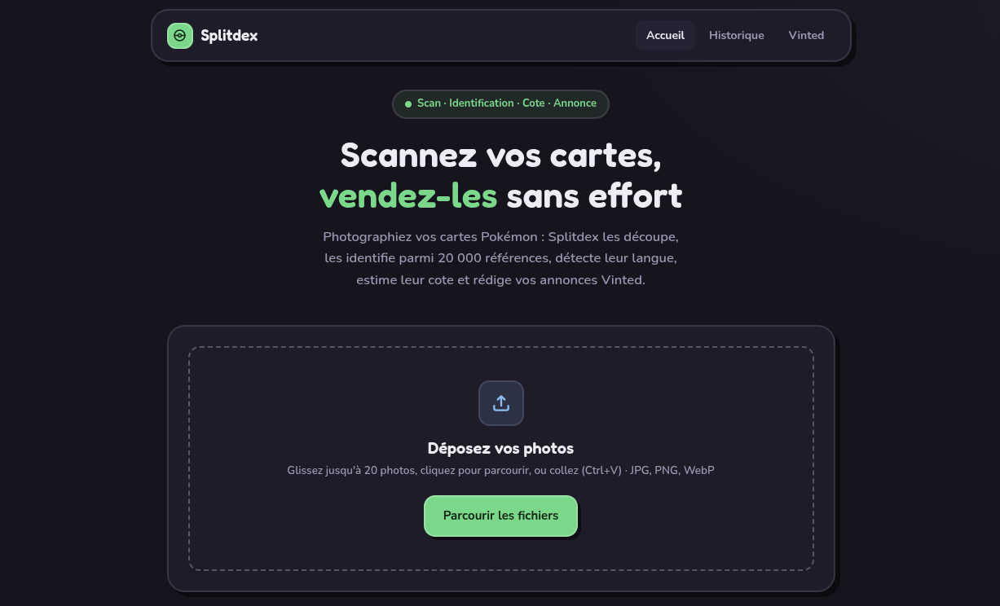

<div align="center">


# Splitdex

**Scannez vos cartes Pokémon, identifiez-les, estimez leur cote et publiez sur Vinted — en local, sans cloud.**

</div>

<div align="center">
  
</div>

---

## Présentation

Splitdex est une application **web locale** : elle tourne entièrement sur votre
machine (aucun service cloud, aucune donnée envoyée sur Internet), et s'ouvre
dans le navigateur. À partir d'une simple photo de vos cartes, elle :

1. **Découpe** automatiquement chaque carte (détection par modèle YOLO local) ;
2. **Identifie** la carte parmi plus de 20 000 références (nom, extension, numéro, rareté) ;
3. **Détecte la langue** d'impression (français, anglais, japonais, allemand, espagnol, italien) ;
4. **Estime la cote** dans le catalogue de cette langue (Cardmarket via TCGdex) ;
5. **Rédige l'annonce Vinted** (titre + description en français, prêts à coller) ;
6. **Remplit le formulaire Vinted** en un clic via un petit script de navigateur — *sans jamais publier à votre place*.

> 🔒 **100 % local.** Aucune identification ou OCR ne passe par un service
> externe : les modèles (YOLO, DINOv2, Tesseract) tournent sur votre machine.
> L'app est accessible depuis les autres appareils de votre réseau (un Mac qui
> se connecte au serveur, par exemple), mais n'est jamais exposée à Internet.

---

## Comment le lancer

**Prérequis :** [Homebrew](https://brew.sh) sur macOS (ou `apt` sur Linux).
Le script `run.sh` installe automatiquement le reste sur macOS — Python 3.12,
Tesseract, et les dépendances Python.

```bash
./run.sh
```

Le script prépare l'environnement puis démarre le serveur. Ouvrez ensuite :

- **Sur la machine qui l'exécute :** <http://localhost:8000>
- **Depuis un autre appareil du même réseau** (ex. un Mac) :
  `http://ADRESSE-IP-DE-LA-MACHINE:8000`
  (trouvez l'IP avec `ipconfig getifaddr en0` sur macOS, `hostname -I` sur Linux).

**Sur une machine neuve**, après le premier lancement, chargez les données de
référence livrées avec le dépôt (instantané, sans réseau) :

```bash
cd backend && source .venv/bin/activate
python -m app.scripts.sync_french_names     # noms officiels français
python -m app.scripts.sync_japanese_cards   # catalogue japonais
```

Ajoutez `--refresh` à l'une ou l'autre pour les re-télécharger depuis TCGdex.

> Détails (pare-feu, cache de 20 000 cartes, embeddings…) dans la
> [documentation technique](doc.md).

---

## Déménager sur une autre machine

Le dépôt contient le code et le modèle de détection, mais **pas** le cache de
référence : 20 448 vignettes de cartes, leurs empreintes visuelles et la base
SQLite pèsent 3,2 Go. Il faut les transférer à part.

| | taille | dans git ? | régénérable |
|---|---|---|---|
| `data/models/card_detector.pt` | 6 Mo | **oui** | non (ré-entraînement) |
| `data/db/reference_thumbnails/` | 3,17 Go | non | oui, mais très long |
| `data/db/card_embeddings.npy` | 30 Mo | non | oui, ~45 min |
| `data/db/splitdex.sqlite3` | 8 Mo | non | **non** — historique des scans |
| `data/uploads/` | variable | non | non — vos photos et découpes |

**1. Fabriquer l'archive** sur la machine d'origine :

```bash
cd ~/Splitdex
tar cf ~/splitdex-data.tar data/db data/uploads data/republish
```

Pas de compression : ce sont des JPEG, `gzip` n'y gagnerait rien et coûterait
plusieurs minutes de calcul.

**2. La transférer.** Par le réseau, depuis la machine d'arrivée :

```bash
scp utilisateur@ADRESSE-IP:~/splitdex-data.tar ~/
```

Une VM libvirt en réseau NAT (`192.168.122.x`) n'est **pas** joignable depuis
l'extérieur de son hôte — vérifiez avec `ping` avant, sinon passez par un
disque externe ou basculez la VM en réseau *bridged*.

**3. La déballer** à la racine du dépôt cloné :

```bash
cd ~/Splitdex
tar xvf ~/splitdex-data.tar
```

Les chemins sont relatifs (`data/db/…`), l'archive se déballe donc à sa place
sans écraser le code.

**4. Vérifier** avant de lancer :

```bash
ls data/db/reference_thumbnails | wc -l   # doit afficher 20448
```

---

## Installer l'extension Vinted (remplissage automatique)

Un petit script remplit le formulaire « Vendre » de Vinted à partir de vos
fiches Splitdex. **Il ne publie rien** : vous relisez, ajoutez les photos et
cliquez vous-même sur « Ajouter ».

1. **Installer Tampermonkey** dans votre navigateur :
   [Safari](https://apps.apple.com/app/tampermonkey/id1482490089) ·
   [Chrome / Edge / Brave](https://chromewebstore.google.com/detail/tampermonkey/dhdgffkkebhmkfjojejmpbldmpobfkfo) ·
   [Firefox](https://addons.mozilla.org/fr/firefox/addon/tampermonkey/)
2. **Installer le script Splitdex** : ouvrez la page **Vinted** dans l'app
   (onglet en haut) et cliquez sur **« Installer le script Splitdex »** —
   Tampermonkey propose l'installation, cliquez sur *Installer*. À faire une
   seule fois (le script se met à jour tout seul ensuite).
3. **Préparer une fiche** : dans Splitdex, sur une carte, cliquez
   **« Envoyer vers Vinted »**.
4. **Remplir** : sur [vinted.fr/items/new](https://www.vinted.fr/items/new), un
   bouton **📋 Remplir depuis Splitdex** apparaît en bas à droite — cliquez.
5. **Relire, ajouter les photos, publier** vous-même.

Le guide complet et le dépannage sont aussi disponibles dans l'onglet **Vinted**
de l'application.

---

## Ajouter l'application sur macOS

Le projet contient **`macos/Splitdex.app`**, un lanceur : un double-clic démarre
le serveur et ouvre Splitdex dans Chrome (ou votre navigateur par défaut).

1. **Premier lancement** (app non signée) — sur **macOS Sequoia**, le clic droit
   → *Ouvrir* ne suffit plus. Le plus simple, depuis le dossier du projet :
   ```bash
   xattr -dr com.apple.quarantine macos/Splitdex.app
   ```
   puis double-cliquez sur `Splitdex.app`. *(Sans Terminal : double-cliquez, puis
   **Réglages Système → Confidentialité et sécurité** → tout en bas, **« Ouvrir
   quand même »**.)*
2. Glissez ensuite `Splitdex.app` dans le **Dock** pour la lancer d'un clic —
   icône Pokéball incluse.

> Gardez le `.app` dans le dossier `macos/` du projet : il y repère la racine
> pour démarrer le serveur.

*Alternative « page web seule »* : dans **Safari**, `Fichier → Ajouter au
Dock…` (n'ouvre pas le serveur, à réserver quand il tourne déjà).

---

## Documentation technique

Le fonctionnement interne détaillé — détection YOLO, identification (pHash / ORB
/ embeddings DINOv2), détection de langue par OCR, estimation de prix,
remplissage Vinted, performances et arborescence du projet — est dans
**[doc.md](doc.md)**.
